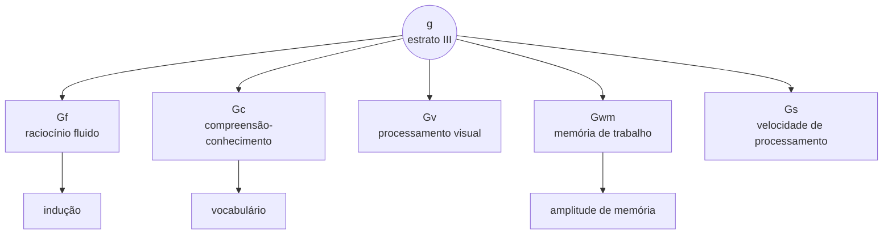

<!--
AULA MODELO. Ela existe para validar a identidade visual da USCS e mostrar, num
assunto de verdade, cada layout e cada componente do design system — um slide de cada:

  capa · roteiro · destaque · secao · figura · fecho · redes · encerramento
  default (com a faixa da USCS) · two-cols-header (layout do Slidev, também com a faixa)
  <Termo> <Nota> <Pessoa> <Citacao> <Grade>+<Cartao> <LinhaDoTempo> <Numero> <Fonte>
  mermaid · tabela em markdown

O conteúdo é um esboço: confira datas, nomenclatura dos subtestes e referências
com a edição do manual que você usa antes de dar a aula.
-->

---
layout: roteiro
kicker: Aula 01
title: O caminho de hoje
itens:
  - { tema: O que é inteligência, desc: a definição de consenso }
  - { tema: O fator g, desc: Spearman e a variedade positiva }
  - { tema: Inteligências no plural, desc: "Thurstone, Cattell, Gardner, Sternberg" }
  - { tema: O modelo CHC, desc: três estratos, uma taxonomia }
  - { tema: Do modelo ao WISC, desc: os índices e o que eles medem }
atual: 1
---

<!-- Layout `roteiro`. `atual` destaca onde a aula está; repita o slide entre as partes mudando o número. -->

---
layout: destaque
kicker: A pergunta
title: Inteligência é uma capacidade ou várias?
fonte: A disputa atravessa um século de psicometria — de Spearman (1904) ao CHC
---

<!--
Layout `destaque`, fundo escuro. Pergunte antes de explicar: anote no quadro as
respostas da turma e volte a elas no fim da aula.
-->

---
layout: default
---

# O que chamamos de inteligência

<Termo palavra="Inteligência" origem="definição de consenso, Gottfredson (1997)">

Uma capacidade mental muito geral que envolve, entre outras coisas, **raciocinar, planejar,
resolver problemas, pensar abstratamente, compreender ideias complexas, aprender
rapidamente** e aprender com a experiência.

</Termo>

<Nota titulo="Repare">

A definição descreve o que a inteligência **faz**, não onde ela está. Toda teoria a seguir é
uma proposta de como organizar essas capacidades.

</Nota>

<Fonte>Gottfredson, L. S. (1997). Mainstream science on intelligence. <em>Intelligence, 24</em>(1), 13–23.</Fonte>

<!-- Layout `default`: o slide comum, branco, com a faixa azul e a marca USCS embaixo. Componentes <Termo>, <Nota> e <Fonte>. -->

---
layout: secao
numero: "01"
kicker: Parte 1
title: O fator g
note: Quem vai bem numa tarefa cognitiva tende a ir bem nas outras. Por quê?
---

---
layout: default
---

# Spearman e a inteligência geral

<Pessoa nome="Charles Spearman" papel="1863–1945 · psicólogo britânico">

Criou a análise fatorial para explicar por que testes muito diferentes se correlacionam.

</Pessoa>

- As correlações entre testes cognitivos são **todas positivas** — a *variedade positiva*
- Um fator comum, **g**, explicaria essa covariação
- Cada teste teria ainda um fator específico, **s**

<Citacao autor="Charles Spearman" fonte="American Journal of Psychology, 1904">

Todos os ramos da atividade intelectual têm em comum uma função fundamental, enquanto os
elementos restantes parecem diferir completamente de um caso para outro.

</Citacao>

<!-- <Pessoa> à esquerda, <Citacao> à direita, dentro de `ds-grid` (duas colunas). Tradução livre da citação. -->

---
layout: figura
imagem: /curva-normal-qi.svg
legenda: Escores compostos do WISC — média 100, desvio-padrão 15. Cerca de 68% das pessoas ficam entre 85 e 115.
lado: direita
---

# O QI como escore padronizado

Desde Wechsler, o QI deixou de ser uma razão entre idade mental e idade cronológica.
Hoje ele é um **escore de desvio**: diz a que distância da média do grupo etário a pessoa
está.

- Média **100**, desvio-padrão **15**
- 85–115: faixa média
- Abaixo de 70 ou acima de 130: cerca de 2% de cada lado

<!-- Layout `figura`: a imagem é o argumento e o texto comenta. `lado: esquerda` inverte. A imagem está em aulas/public/curva-normal-qi.svg. -->

---
layout: secao
numero: "02"
kicker: Parte 2
title: Inteligências no plural
note: As respostas ao fator g — de capacidades primárias a modelos fora da psicometria.
---

---
layout: two-cols-header
---

# Cattell: fluida × cristalizada

Raymond Cattell (1941, 1963) dividiu o fator geral em dois.

::left::

**Inteligência fluida (Gf)**

Raciocinar diante do novo: perceber relações, induzir regras, resolver problemas sem
depender do que se aprendeu.

::right::

**Inteligência cristalizada (Gc)**

Conhecimento acumulado pela cultura e pela escola: vocabulário, informação geral,
compreensão verbal.

<Nota tipo="ok" titulo="Na prática">

Gf tende a declinar a partir da idade adulta; Gc se mantém ou cresce por mais tempo.

</Nota>

<!-- `two-cols-header` é um layout do próprio Slidev — continua com a faixa da USCS porque o fundo vem do CSS base. `::left::` e `::right::` separam as colunas; o que vem antes é o cabeçalho. -->

---
layout: default
---

# Três respostas ao fator g

<Grade :cols="3">
<Cartao rotulo="Thurstone · 1938" titulo="Capacidades primárias">

Sete capacidades relativamente independentes: compreensão verbal, fluência, número,
espaço, memória, percepção e raciocínio.

</Cartao>
<Cartao rotulo="Gardner · 1983" titulo="Inteligências múltiplas" destaque>

Sete inteligências (oito desde 1999), definidas por critérios biológicos e culturais — influente na
educação, com pouco apoio psicométrico.

</Cartao>
<Cartao rotulo="Sternberg · 1985" titulo="Teoria triárquica">

Inteligência analítica, criativa e prática: a capacidade de se adaptar ao próprio
contexto.

</Cartao>
</Grade>

<Fonte>O <code>destaque</code> pinta um cartão por grade — aqui, o modelo que mais circula fora da psicometria.</Fonte>

<!-- <Grade :cols="3"> com três <Cartao>. -->

---
layout: secao
numero: "03"
kicker: Parte 3
title: O modelo CHC
note: Cattell, Horn e Carroll — a taxonomia por trás dos testes atuais.
---

---
layout: default
---

# Como se chegou ao CHC

<LinhaDoTempo :itens="[
  { quando: '1904', o_que: 'Spearman', desc: 'fator geral g' },
  { quando: '1938', o_que: 'Thurstone', desc: 'capacidades mentais primárias' },
  { quando: '1963', o_que: 'Cattell e Horn', desc: 'teoria Gf-Gc, depois ampliada por Horn' },
  { quando: '1993', o_que: 'Carroll', desc: 'teoria dos três estratos, reanálise de mais de 460 bancos de dados' },
  { quando: '1997–2009', o_que: 'McGrew', desc: 'integração das duas: o modelo CHC' },
]" />

<!-- <LinhaDoTempo>: serve para história e para processo. O campo `quando` é texto livre. -->

---
layout: default
---

# Três estratos

<Fonte>Estrato III: g · estrato II: capacidades amplas (apenas cinco das mais de dez do modelo) · estrato I: capacidades restritas (exemplos).</Fonte>

<!-- Diagrama mermaid, com as cores da USCS definidas em aulas/setup/mermaid.ts. -->

---
layout: secao
numero: "04"
kicker: Parte 4
title: Do modelo ao WISC
note: Escala Wechsler de Inteligência para Crianças — quinta edição.
---

---
layout: default
---

# O WISC-V em números

<Grade :cols="3">
<Numero valor="6–16" rotulo="anos de idade" detalhe="de 6a 0m a 16a 11m" />
<Numero valor="5" rotulo="índices primários" detalhe="um para cada capacidade ampla do CHC" />
<Numero valor="10" rotulo="subtestes primários" detalhe="7 deles compõem o QI total" />
</Grade>

<Nota tipo="alerta" titulo="Atenção">

O QI total resume o desempenho, mas a interpretação clínica começa pelos **índices** —
discrepâncias entre eles dizem mais que o número global.

</Nota>

<!-- <Numero> dentro de <Grade :cols="3">: o valor sai em Poppins no degradê da marca. -->

---
layout: default
---

# Índices do WISC-V e o CHC

| índice | capacidade ampla (CHC) | exemplos de subtestes |
|---|---|---|
| Compreensão Verbal (ICV) | Gc · conhecimento | Semelhanças, Vocabulário |
| Visuoespacial (IVE) | Gv · processamento visual | Cubos |
| Raciocínio Fluido (IRF) | Gf · raciocínio | Raciocínio Matricial |
| Memória Operacional (IMO) | Gwm · memória de trabalho | Dígitos |
| Velocidade de Processamento (IVP) | Gs · velocidade | Código, Procurar Símbolos |

<Fonte>Confira a nomenclatura dos subtestes com o manual da edição brasileira em uso.</Fonte>

<!-- Tabela em markdown puro: o cabeçalho ganha o traço laranja; sem componente nenhum. -->

---
layout: default
---

# Três cuidados na interpretação

<Nota tipo="ok" titulo="Faça">

Integre o escore à história clínica, à escolaridade e à observação durante a aplicação.

</Nota>

<Nota tipo="alerta" titulo="Atenção">

Escore é estimativa: relate sempre com o **intervalo de confiança**.

</Nota>

<Nota tipo="erro" titulo="Não faça">

Tratar o QI como medida fixa e definitiva da pessoa.

</Nota>

<!-- Os quatro tipos de <Nota>: info (padrão), ok, alerta, erro. -->

---
layout: fecho
title: O que fica
pontos:
  - "<strong>g</strong> explica a variedade positiva, mas não esgota a inteligência"
  - "O <strong>CHC</strong> organiza as capacidades em três estratos"
  - "Os índices do <strong>WISC-V</strong> correspondem a capacidades amplas do CHC"
proximo: "Aula 02 — WISC-V: aplicação, correção e interpretação"
---

Leitura: Schneider, W. J. & McGrew, K. S. (2018). The Cattell-Horn-Carroll theory of
cognitive abilities. In D. P. Flanagan & E. M. McDonough (Eds.), *Contemporary
intellectual assessment* (4th ed.). Guilford.

<!-- Layout `fecho`: os pontos que ficam, o que vem a seguir e, no corpo, as referências. -->

---
layout: redes
---

<!-- Layout `redes`: o slide institucional com as redes da Pós-graduação USCS, sem campos. -->

---
layout: encerramento
---

<!-- Layout `encerramento`: o "Obrigado(a)!" do modelo. `title` e `subtitle` trocam a frase. -->
